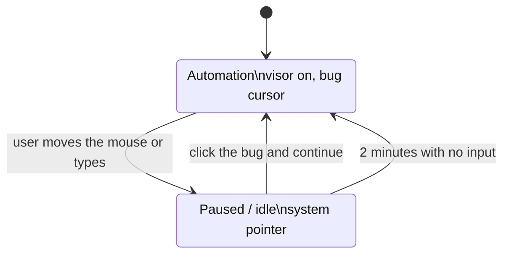

# hypermesh-visor

`hypermesh-visor` is a local Linux daemon a supervisor starts for a desktop session. Open a session, then call view, watch, listen, mouse, and type. Calls without a live session fail. It is not a virtual machine. This version is Linux only.

Purpose, recipes, agent, skills, and secrets are sent when the session opens. Only secrets included in that call are loaded. Url/chain/ipfs *secret* sources stay 501. Vault `source: "mcp"` (role B) materializes via a short-lived MCP tool call.

Optional `mcp_profile` on `POST /session` attaches local MCP *tool* servers from `~/.config/hypermesh/mcp.json` and `mcp-profiles.json` (same files as `hypermesh mcp`). Stdio and HTTP/SSE servers are attached (`tools/list` on connect). Closing the session kills stdio children and drops HTTP clients. Project-local `.hypermesh/mcp.json` or `.cursor/mcp.json` (cwd walk, or `HYPERMESH_MCP_PROJECT`) is merged under user config. A profile with `gateway: true` attaches only `docker-gateway`. `GET /session/{id}/mcp` returns the attached profile, servers (with `healthy`), and tools. `GET /companion` includes prefer-MCP fields: `mode` (`mcp:<id>` when a healthy binding matches the focused app, else the desktop verb), `mcp`, `prefer_mcp`, and `focused`. Focused-app detection uses X11 `WM_CLASS` and best-effort Wayland probes (Hyprland `hyprctl`, Sway `swaymsg`, KWin `qdbus`). Bindings live in `mcp-bindings.json`. `POST /session/{id}/mcp/call` invokes a tool with `approve`/`deny`; `GET /mcp-audit` lists server, tool, decision, and outcome only (never env or arguments). Vault locator is `server/tool` in `mcp.json` (role B — separate from session tool attach).

`hypermesh-desktop-mcp` is an inverse stdio MCP that wraps visor view/mouse/type for external agents. It uses the control socket by default. `HYPERMESH_VISOR_URL` selects the opt-in TCP listener, and `HYPERMESH_SESSION_ID` names the session.

## Linux build and tests

Stable Rust. The workspace tests do not need a display server.

```bash
cargo test
cargo build --release
./target/release/hypermesh-visor
```

Run the daemon as the logged-in user, not as root. It prints `control socket` and `companion socket` when those sockets are up. TCP stays closed unless `--tcp` or `HYPERMESH_TCP=1` is set. `--listen` then sets that loopback port (default `127.0.0.1:9847`).

### Display harness

`ci/display/run.sh` drives the visor and the companion on a real display. GitHub Actions runs the same script as `display-x11` and `display-wayland`. Each scenario has its own timeout. A failure leaves logs and a capture (`xwd` on X11, `grim` on Wayland) in `display-logs/`.

X11 uses Xorg with the dummy video driver. Injected mouse and type go through XTEST, and a small `xev` window checks that those events landed. Physical input is separate: the harness creates a pointer and a keyboard with `/dev/uinput` (`sudo modprobe uinput`). libinput attaches those nodes as slave devices. If libinput does not attach them, the same nodes are handed to the evdev driver. They are not the XTEST pointer or keyboard, and the harness does not pretend that XTEST input is physical. The companion's XTEST classification is what the pause and click scenarios exercise.

```bash
sudo modprobe uinput
cargo build --locked --workspace --bins
bash ci/display/run.sh x11
bash ci/display/run.sh x11 inject-lands
bash ci/display/run.sh wayland
```

X11 scenarios: `key-down-detects`, `inject-lands`, `stop-resume-during-type`, `uinput-key-pauses-type`, `uinput-move-pauses`, `pausing-click-does-not-ask`, `off-bug-toggles-menu`, `xtest-click-does-nothing`, `watchdog-pauses`, `held-release`, `auto-resume`, `tcp-start-without-poll`. An unknown name exits non-zero and lists these names. `key-down-detects` holds an XTEST key down with no up and checks that `key[$code]=down` is reported. `stop-resume-during-type` posts stop and then resume while a long type is still injecting; the type is cancelled and the phase is running again. `off-bug-toggles-menu` clicks the bug while automation is off and expects the menu to open and close.

`auto-resume` sets `HYPERMESH_AUTOMATION_RESUME_SECS` on the companion process so the idle resume is a couple of seconds. Unset, or set to anything that is not a positive integer, the companion keeps `automation_resume_secs` from `companion.toml`, or 120 seconds. That variable does not change the default.

The hosted Wayland job uses weston `--backend=headless` and `--socket=hm-display`. Sway does not stay up on these runners: it exits with no DRM render node, and `WLR_RENDERER=pixman` does not change that, so sway is not the path this job runs. The script still tries sway first. If a local sway stays up, the script takes the `wayland-N` socket from sway's log or from a new socket in `XDG_RUNTIME_DIR`, not a name the client exported. `start`, `mouse`, and `type` must fail with the issue #17 error, and the companion must still be running. Portal and libei checks are a skipped placeholder in that script until issue #17 lands. An unknown Wayland scenario name exits non-zero and lists `wayland-refuses-automation` and `portal-libei`.

## Release packages

Pull requests and `main` build Linux artifacts. Those builds are not a release. Their version is the `Cargo.toml` version plus `~ci.` and the commit. A release is a tag named `v` plus that same `Cargo.toml` version, pushed after the version is on `main`. The workflow refuses a tag that does not match.

```bash
git tag v0.1.0
git push origin v0.1.0
```

The release asset names do not include the version. `v0.1.0` publishes:

- `hypermesh-visor-x86_64`
- `hypermesh-visor-x86_64.deb`
- `hypermesh-visor-x86_64.rpm`
- `hypermesh-visor-aarch64`
- `hypermesh-visor-aarch64.deb`
- `hypermesh-visor-aarch64.rpm`
- `checksums.txt` — SHA-256 of those files

The version is inside the package. The download page uses these same filenames.

The packages install `/usr/bin/hypermesh-visor`, `/usr/bin/hypermesh`, `/usr/bin/hm`, `/usr/bin/hypermesh-companion`, and `/usr/bin/hypermesh-desktop-mcp` when present in the build. They do not start the visor. The companion is started for a graphical login from `/etc/xdg/autostart`. Run the visor as the logged-in user. Builds run on Ubuntu 24.04, the same userspace generation as the AGX JetPack 7 image.

The raw release assets `hypermesh-visor-x86_64` and `hypermesh-visor-aarch64` stay the visor binary. The `.deb` and `.rpm` names are unchanged and are the packages that contain the visor, the CLI, and the companion.

## Desktop companion

`hypermesh-companion` is a Linux-only bug on the desktop. It plays the animated states in [`companion/assets/states`](companion/assets/states/README.md). Frame order, `ms_per_frame`, and `loop` come from `states.json`. The window uses the `400x520` frames.

| State | When it shows |
| --- | --- |
| idle | The visor is reachable and was used recently, and while an automation is paused |
| automation | The visor is driving the desktop, or a caller started an automation |
| upgrading | An updater published that notice (see below). This wins even if the visor is down |
| disconnected | The visor does not answer. Three missed polls in a row count as down |
| sleeping | The visor is up, nothing is driving, and neither the companion nor the open session has been used for `sleep_after_secs` (default 900) |

While a visor session is open it paints that session's purpose and the prefer-MCP mode (`mcp:<id>` when a healthy binding matches, else `view` / `watch` / `listen` / `mouse` / `type`) under the bug in a built-in bitmap face. It does not copy the screen into the window. Clicking it opens a short menu: a terminal running `hypermesh`, MCP profiles, MCP doctor, login, billing (`https://hyperme.sh/#pricing`), renting (`https://hyperme.sh/#offers`), the desk (`https://portal.test.hyperme.sh/dashboard/hypermesh`), Eyes follow, and Bug cursor. On a short display the window is capped to the screen and the wheel scrolls the rows, so the last item stays reachable. Eyes follow and the bug cursor are off unless that menu row turns them on. Both choices are stored in `~/.config/hypermesh/companion.toml` (`eyes_follow_pointer`, `bug_cursor`). Pupils track the pointer only on the idle animation, and only while a session is open and eyes follow is on. `sleep_after_secs` and `automation_resume_secs` (default 120) are read from that file when the companion starts. Polls and pause posts use the Unix socket `$XDG_RUNTIME_DIR/hypermesh/companion.sock` (directory mode 0700, socket mode 0600). `HYPERMESH_RUNTIME_DIR` overrides that directory. When `XDG_RUNTIME_DIR` is unset, both sides use `$XDG_STATE_HOME/hypermesh/run`, or `~/.local/state/hypermesh/run` when that is unset too. A path that does not fit in `sun_path` fails closed. Session tools and the desktop MCP still use `HYPERMESH_VISOR_URL` (default `http://127.0.0.1:9847`) on the loopback TCP port.

The bug cursor art is in [`companion/assets/cursor`](companion/assets/cursor/README.md). How it pairs with the automation state is [Automation mode](#automation-mode).

### Automation mode

The top-down bug cursor and the automation state are one behavior. The visor is the bug using VR to do the tasks.

While an automation runs, the companion shows the automation state and the pointer is the bug cursor. The system sprite is hidden for that time, and a click-through window follows the pointer so a window's own cursor, such as a text caret, does not cover the bug. That path leaves the root window's cursor as it was. If the overlay cannot be created, the companion sets the root cursor and restores the default cursor on the way out. A missing extension is logged once and further overlay attempts stop. The click point is the antenna tip in `hotspot.json`. The cursor plays crawl, fly (a long move, or a fast one), reach, click, type, and busy from the latest drive sample. Reach shows only after a move has settled and that move's JSON set `"clickable": true`. The visor does not discover clickable targets. Busy shows while the automation is running and the latest sample is not a fresh move, click, or type.

`POST /session/{id}/mouse` and `POST /session/{id}/type` enter `running` before the first desktop call, except while the injection backend is Wayland. Those calls are refused and do not enter `running`. `view`, `watch`, and `listen` do not. There is no separate automation runner. `POST /companion/automation` with `{"action":"start"}` or `"stop"` is that seam. `start` needs an open session. While a session is already driving, `start` keeps that session and does not move the quiet-poll clock. It uses the most recently touched session only when the gate is off. A TCP `start` or `resume` that would enter `running` needs a companion-socket `GET /companion` inside the watchdog window; otherwise it returns 503 `no recent companion poll` and does not grant a grace. During an injection that check uses the phase the controls already queued would leave, not the phase still published as `running`. A stale start or resume returns 503 and is not queued. Replaying the queue checks that poll against the clock at unwind, plus the keyboard latch and the session the action named. A start or resume whose poll has expired by then does not enter `running`, even when the poll was fresh at the moment the action was queued. `stop` ends the phase without closing the session. Closing the driving session ends a running automation. It does not clear a user pause. A close that arrives during an injection names that session and generation. A start during that call joins the same sequence, so the close does not clear the session the start named.

A real mouse move, button press, or key press pauses the automation. The companion posts `pause`. That pause publishes the new epoch and `paused` in one step, and it does not wait for an in-flight injection to finish. Each mouse or type request reads that snapshot once before it checks the phase, and checks the same value again immediately before every injection call, so a pause that lands after the request is admitted still cancels it. A TCP `stop` during an injection cancels it the same way and leaves the phase `running` until the call ends; it does not publish `off` underneath the call. Type reuses one keyboard connection and keymap for every chunk of the request. Type is sent in batches of 32 keystrokes, and one type request is limited to 4096 keystrokes. A drag longer than 64 px is sent as pointer steps on one connection, in batches of 16 between cancellation checks, and a drag of more than 4096 steps is refused. Pointer coordinates are rejected before that interpolation: X11 and the fixture allow the signed 16-bit range, and Wayland allows ±1,048,576. When the root window size is known, a coordinate outside that rectangle is refused the same way. The drive sample stores the pointer position after the injection when the backend can read it. Between batches the visor checks the latch and returns 409 with how many keystrokes or pointer steps were already sent. Buttons and keys that this request pressed are released in reverse order when the request finishes, including a success that left one down, and also on cancel, on a desktop error, and if the call panics. A click or a short drag notes its button before the desktop call. A type chunk notes each down, including an implicit Shift, before the chunk is sent. A key or button that is not down can still be released. A hold does not carry into the next request. A caller that needs a modifier puts the down, the keys, and the up in one body. After the pause has landed, mouse and type return 409 `{"error":"automation paused"}` and do not inject. XInput2 raw events whose device or source is an XTEST device are the visor's own input and are ignored. The core button press paired with that raw press is ignored as well, so an injected click on the companion does not pause the automation or activate a menu row. The visor publishes its injection backend on `GET /companion`, and the companion applies that before it reads queued raw events. While `backend` is `wayland`, automation is disabled until issue #17 lands. `POST /companion/automation` with `start` or `resume`, and session `mouse` and `type`, return 501 and the error `Automation is disabled on Wayland until the portal backend lands (#17)`. They do not inject. The portal pointer and keyboard code stays in the visor and is not called. The companion does not show the visor state. The menu shows that sentence, and the companion logs it once. If X11 cannot identify XI2 or the XTEST keyboard, the companion cannot see key presses. Every companion poll then sends `x-hypermesh-keyboard: 0`, and the companion also posts `no keyboard interrupt available` again whenever the visor instance nonce changes. It logs that sentence once and shows it in the menu. Accepting the report pauses any active phase and bumps the epoch, so an in-flight chunk stops at its next check. Finding the XTEST pointer without the keyboard still filters pointer motion and buttons, and it does not treat a synthetic key as a physical key. Finding the keyboard without the pointer keeps that key filter and uses the pointer fallback for motion and buttons. The visor then refuses `start`, `resume`, `mouse`, and `type` with 501 and that same sentence. Idle, sleeping, disconnected, and upgrading keep working, and the optional bug cursor still follows the pointer. `view`, `watch`, and `listen` stay available. If XInput2 or the XTEST pointer cannot be identified, the companion compares the pointer with the last drive point once the companion has been showing that sample for 150 ms, and pauses when it is more than 12 px away. While automation is off, that same pointer sample only refreshes idle time. It does not pause, and it does not become the baseline used once automation is running. A single poll is not enough: the move can reach the screen before that poll fetched the new drive, so the mismatch has to still be there on two later polls of the same sample. A new button in the pointer mask pauses too. The drive sample is published only after the visor has pressed and released, so a button that goes down once that sample is visible is a physical press. A press and release shorter than one frame can be missed, and this fallback cannot see key presses. Before `mouse` or `type` runs, the visor publishes `running` and `injecting` and bumps `inject_seq`. It clears `injecting` when the call finishes and publishes `last_settled_seq` for that sequence, including when the call fails, so a failed injection stops deferral on the next poll. While a sequence is still outstanding, the fallback defers button and displacement checks. Back-to-back injections share one 2 second budget from the last poll that showed no injection in flight, so a new sequence does not restart the wait. Samples seen during that wait are not copied into the baseline. When the injection settles, or the budget runs out, a move or a button change is judged against the pointer from before the deferral, or against a usable drive. A hung chain cannot suppress pausing past that budget. When there is no usable drive (just after start or resume, or a type sample with no pointer), the fallback keeps a live pointer baseline and pauses on a later move or button change. The injection marker keeps the visor's own move off that baseline until the wait ends. While paused, that fallback keeps watching the pointer and buttons against the sample taken when the pause began, and a later change restarts the resume timer. `resume` and `start` drop that drive sample and bump a resume sequence. The companion ignores a drive from the sequence before that transition, so a sample recorded between the resume and the poll that reports it still counts, and a later user move still pauses. The visor poll and those posts run on a side thread, so a slow reply does not freeze the cursor or hold the pause. Polls wait 40 ms while the automation is running or paused, and 250 ms otherwise. While the gate is running, the visor pauses if the companion socket has not completed a `GET /companion` within 2 seconds. A poll that arrives after that gap pauses before the poll is stored, so it does not refresh the heartbeat. Only that companion-socket poll extends the deadline. A transition into `running` that arrives on the companion socket grants one grace window of the same length. A TCP transition does not, and a TCP `stop` followed by `start` does not either. A TCP `start` while the gate is already running clears the drive and bumps the resume sequence, and it does not move that clock. `start` and `resume` do not wait for an in-flight injection. While a call is injecting they join the deferred sequence, and the newest control is what remains when the call ends: a stop posted after a pause ends `off`, a pause posted after a stop stays `paused`, and a companion start or resume posted after either stays `running`. A TCP start or resume that would re-enter after a queued stop, close, or pause returns 503 `no recent companion poll` unless a companion-socket poll is inside the window. A missing keyboard still ends `paused` when the phase it replays against is `running`. A later stop stays `off`: the keyboard report does not turn that `off` back into `paused`. Repeated reports of the same missing keyboard during one injection do not queue again. A start or resume with no injection in flight publishes immediately. Closing the driving session while an injection is in flight does not reset the gate until that call ends, and the close does not apply to a session it did not name. Shutdown bumps the epoch and waits about 2 seconds for the injection lock. The process exits within about 5 seconds even if a desktop call is still blocked inside one request, and the runtime applies that same bound when it shuts down after a clean return. The X server drops that client's grabs when the process exits. `HYPERMESH_COMPANION_POLL_MS` sets that window when it is a number from 200 to 60000; any other value keeps 2 seconds. A poll on the loopback TCP port does not count. The pause is the same latch as a user pause, so only a companion `resume` lifts it, and mouse and type return 409. That covers a companion that exited, a poll the companion could not read, and an accept loop that stopped taking connections. A truncated poll, or a 200 body the companion cannot parse, while automation is running or paused, posts `pause` and does not count as a disconnect. Session strings are capped at the API: purpose and names at 512 characters, instructions and recipe steps at 2048, and those lists at 16 entries. A longer field is a 400. `GET /companion` also clips those strings so one poll stays well under the companion's 256 KiB read. `GET /companion` caches the focused app for about 750 ms and refreshes it off the request worker, and only when a session is open, so an idle Wayland desktop does not spawn a focus helper. `mcp-bindings.json` is cached and stat'ed at most about once a second, and only re-read when its mtime changes. That read is not done while the sessions lock is held. On pause the companion drops the visor, shows idle, and the system cursor comes back.

While paused, clicking the companion bug asks whether to continue. The click that paused the automation does not open that prompt; Continue takes a later click. That ask happens only when the phase is still paused. If the snapshot has left paused, the click follows the phase on screen: a running automation pauses, and off toggles the menu. Continue posts `resume` and, on the pointer fallback, rebaselines to the pointer and button mask at that click. The button-up of every button that was down at Continue is ignored until each of those buttons is released, so holding Continue across more than one sample does not pause. A later press or move still pauses. A resume that fails while the visor socket is down is dropped: new input or a disconnect cancels the queued resume, and the local phase stays paused so input still restarts the timer. The companion does not replay that resume when the socket returns. The automation also resumes after `automation_resume_secs` (default 120) with no user input. A later `running` report follows that pause when its resume sequence is newer than the sequence at the pause, including when the poll skipped the `paused` state. A `running` report with the same sequence is from before the pause and is ignored. A `paused` report while a local resume is in flight is ignored when its resume sequence is the one that pause was based on, or older. A newer sequence is a re-pause and is followed. Further mouse or keyboard input during that wait keeps it paused and restarts the timer. On resume the visor state and the bug cursor come back.

`GET /companion` publishes `instance`, a nonce chosen when that visor process starts. When it changes, the companion drops its pause mark, resume marks, inject and settled marks, and the pointer baseline. If it was locally paused, that poll posts `pause` again and does not follow the new snapshot. The pause mark becomes the new snapshot's `resume_seq`, so the same sequence cannot undo the pause. A companion `pause` latches from any phase, including off. A TCP `stop` that lands first does not drop it, and a TCP `start` cannot clear it. Mouse and type stay blocked until a companion `resume` or a companion `stop` on the socket. Resuming a pause whose driving session was closed assigns the session selected for that resume. With no session left, the phase ends as off.

| Case | What the companion does |
| --- | --- |
| Start, or resume, with no usable drive | The first pointer sample is the baseline. A later move of more than 12 px, or a button change, pauses. |
| Type sample with no pointer | The same baseline. The type coordinates are not a target. |
| Click or drag in flight | Button and displacement checks wait while an injection is outstanding. The whole chain shares one 2 second budget from the last quiet poll. Samples during the wait stay off the baseline. |
| Failed mouse or type | `last_settled_seq` catches up to `inject_seq`, and the next poll classifies immediately. |
| Click or drag after that drive is visible | Displacement is compared with the drive and has to survive two later polls. Age is how long the companion has been showing that sample. A button pauses only when it is newly pressed. |
| Injection still open after 2 seconds | Checks resume against the pointer from before the deferral, so a move during the wait still pauses. |
| TCP `start` clears the drive | The baseline still pauses on a later physical move. |
| Re-pause while a resume is in flight | A paused snapshot counts when its `resume_seq` is newer than the pause. The same or an older sequence is ignored. |
| Backend is Wayland | Automation stays off until issue #17. The companion does not enter the visor state. Idle, sleeping, disconnected, upgrading, and the optional bug cursor keep working. |
| Reconnect | The same `resume_seq` does not undo a local pause. A newer running snapshot follows. |
| Visor process restarts | `instance` changes. Resume, pause, and inject marks and the pointer baseline reset. A local pause is posted again instead of following the new running snapshot. |
| TCP stop, then companion pause | The pause latches from off. A later TCP start stays refused, and mouse and type stay blocked until a companion resume or stop. |
| Missed poll | The poll epoch does not bump, so a displacement does not confirm. |
| Automation off, fallback pointer | Movement and button changes refresh idle time. They do not pause. |
| Pause during a long type or drag | The pause does not wait for the injection to finish. The next batch stops, the response is 409 with a partial count, and buttons or keys that request pressed are released. A desktop error or a panic releases them too. |
| Key or button left down | The request releases it when the request finishes. The next request does not inherit that hold. |
| Companion poll goes quiet | While running, about 2 seconds without a companion-socket poll pauses the automation. Only a companion resume lifts it. Mouse and type return 409. A TCP poll does not refresh the timer, and a TCP start while already running does not either. A TCP start from off returns 503 `no recent companion poll` unless a companion-socket poll landed inside the window, and repeating stop and start does not extend it. |
| Companion poll does not parse | A truncated read or a 200 body that does not parse, while automation is running or paused, posts pause. The companion stays on the last snapshot instead of dropping to disconnected. |
| Pointer coordinate out of range | The request is refused with 400 before any drag step is built. Nothing is injected. |
| Continue held across a pointer sample | The fallback baseline becomes that sample. Releasing every button that was held at Continue does not pause. A later press or move does. |
| No keyboard interrupt | Every companion poll reports it, and the post is sent again when the visor instance changes. The gate treats the report as a level: the change from available to unavailable pauses a running phase and bumps the epoch once. Further polls in that injection do not queue another pause, and replaying the report does not turn `off` back into `paused`. Start, resume, mouse, and type return 501 `no keyboard interrupt available`. The menu shows that sentence. |
| Stop during an injection | The epoch bumps and the phase stays until the call ends. A later pause stays paused. A stop posted after that pause ends `off`. A start or resume during the call is in that same sequence, so the newest control remains. |
| Session close during an injection | The poll does not reset the gate. The close is applied when the call ends, and only to the session it named. |
| Late companion poll | A gap that already exceeded the timeout pauses, and that poll is not stored as a new heartbeat. |
| New running stretch | A companion-socket transition from off or paused into running grants one grace window. A control-socket or TCP transition does not. A control-socket or TCP start while already running does not move that clock. Only a companion-socket poll extends it. |
| Physical input, then an off poll | Queued XInput is judged against the phase already on screen. A pause from that input is still posted when the new snapshot is off. |
| Physical input before the first running snapshot | That queued event is also judged against the incoming phase. An off-to-running transition in the same frame still pauses. |
| Physical input, then a newer running snapshot | The same event is classified again when the snapshot is running, including when that snapshot lifted the pause in this frame. The companion pauses that stretch instead of showing running until the pause post returns. |

Phase, epoch, the inject marker, the quiet-poll clock, and the driving session live on one gate. Injection threads only read a published snapshot between chunks.

| From | To | What happens | Who |
| --- | --- | --- | --- |
| off | running | `start` on the control socket or on opted-in TCP needs a companion-socket poll inside the watchdog window, or it returns 503 `no recent companion poll` and does not grant a grace. A companion-socket start grants one grace. `begin-inject` arms one window when none is recorded | companion socket, or the control socket / opted-in TCP after a fresh companion poll when the gate is not paused |
| off | paused | pause latches | companion socket |
| running | paused | pause, a late companion poll, the watchdog, or a missing keyboard | companion socket, or the watchdog |
| running | off | stop when nothing is injecting, or the driving session closes | companion socket, control socket, opted-in TCP, or close |
| running | off, after the call | stop or session close during an injection, replayed in the order they arrived. A newer stop ends off. A newer pause stays paused. A close applies only to the session and generation it named. A missing-keyboard report pauses only a running phase, so it does not turn that off back into paused | control socket, opted-in TCP, companion socket, or close |
| running or paused, during an injection | running, after the call | `start` or `resume` joins that sequence before any phase no-op. Admitted against the phase earlier controls would leave, a companion start or resume after a stop stays running, and a resume after a pause stays running. A control-socket or TCP start or resume that would enter `running` needs a companion poll inside the window, or it returns 503 and is not queued. A missing keyboard still ends paused | companion socket, or the control socket / opted-in TCP after a fresh companion poll |
| paused | running | resume or start | companion socket |
| paused | off | stop, or resume with no session left | companion socket |
| any | off | shutdown bumps the epoch, waits about 2 seconds for the injection lock, and the process exits within about 5 seconds | close |

Lifting a pause is reserved for the companion process running as the same user. Two sockets share one runtime directory, mode 0700: `$XDG_RUNTIME_DIR/hypermesh` (`HYPERMESH_RUNTIME_DIR`, or `$XDG_STATE_HOME/hypermesh/run`, or `~/.local/state/hypermesh/run`). Each socket is mode 0600. A path that does not fit in `sun_path` is refused. The owner is checked. A second visor leaves a live socket in place and exits with `visor already running`. The visor holds an exclusive lock on `companion.lock` for its lifetime.

`control.sock` is the control API: sessions, view, watch, listen, mouse, type, and start/stop/resume. The visor accepts a connection only when `SO_PEERCRED` uid equals its own uid, and then drops the connection before reading a request. That socket cannot lift a user pause. `companion.sock` is separate. The companion polls and posts there, with the same uid check. `resume`, and `start` or `stop` while the gate is paused, are accepted only on the companion socket. The same actions on the control socket are refused, including with a header, and deleting the driving session does not clear the pause. Pause itself is allowed on the control socket. `start` while the gate is off needs a companion-socket poll inside the watchdog window, and returns 503 `no recent companion poll` otherwise. A transient accept error is retried with backoff. A dead listener still stops the loop.

TCP is off unless `--tcp` or `HYPERMESH_TCP=1` is set. The port is loopback only (`--listen`, default `127.0.0.1:9847`). When TCP is enabled, the visor binds that port before it replaces a stale socket file, writes a new random bearer to `api.token` (mode 0600) in the runtime directory, and rejects every request that does not present it with 401 before any handler runs, including `/health` and unknown paths. The compare does not stop at the first mismatched byte. The bearer has the same privileges as the control socket: it cannot lift a user pause. When TCP is off, that token file is removed. Another OS user cannot connect to either socket and cannot read the token. Loopback alone does not keep that user out, which is why the port is closed unless this opt-in is set. `hypermesh-desktop-mcp`, the `hypermesh` CLI prompt, and `ci/verbs.sh` use the control socket unless `HYPERMESH_VISOR_URL` (or `--visor`) names the TCP base. Windows and macOS need the same boundary with a named-pipe ACL and an XPC or peer audit token, tracked in issue #18. `companion.toml` is TOML: `sleep_after_secs = 1_800` and `automation_resume_secs = 600 # ten minutes` are read as written. A write replaces the root key in the parsed table and saves it, so a trailing table keeps its own keys. An invalid value logs a warning and that setting stays at its default.

Away from an automation the bug cursor stays off unless `bug_cursor` is true.

The system cursor is restored when the companion exits, when the visor is disconnected, and if the window loop unwinds. The X server also drops a client's cursor when the connection closes. The pointer change is the X11 cursor, including XWayland. A Wayland-native cursor that does not go through XWayland is left as it is.

Upgrading is not inferred. Publish it with `POST /companion/notice` and `{"notice":"upgrading"}` (`{"notice":"clear"}` removes it), or write the single word `upgrading` to `~/.config/hypermesh/companion-notice`. The window stats that file at most once a second and reads it only when the mtime changes. The rest of the frame loop does not touch the filesystem or spawn a process. Settings writes, login, and `xdg-open` run only from a menu click.



Sign in opens your browser; after you approve, Hypermesh stores your session in your system keychain. On a machine without a browser, use `hypermesh login --device`.

The public Keycloak client is `hypermesh-native` in realm `controlplane` at `https://auth.test.hyperme.sh`. It has no client secret. It must allow the loopback redirect `http://127.0.0.1/callback` with any port (register that URI with no port; do not pin port 3000), require PKCE S256, and enable the device authorization grant. Sign-in requests the `openid` scope only. The refresh token is the normal SSO-session token, stored once under keychain service `hypermesh` and account `session`, which the CLI and the companion both read. Access tokens stay in memory. When the Keycloak session ends, Hypermesh clears that entry and asks you to sign in again. `hypermesh logout` revokes the refresh token and deletes the entry. The companion polls `GET /companion` on its Unix socket and does not put the session in the visor vault.

The window uses X11, including XWayland. It needs `DISPLAY`.

```bash
curl --unix-socket "${XDG_RUNTIME_DIR}/hypermesh/control.sock" \
  -s -X POST http://localhost/session \
  -H 'content-type: application/json' \
  -d '{"purpose":"look at the desktop","recipes":[],"agent":{"name":"local","instructions":""},"skills":[]}'
```

## Verb checks

`ci/verbs.sh` starts the daemon with `--fixture` and calls view, watch, listen, mouse, and type on the control socket. `ci/cross-user.sh` checks that TCP stays closed and that another Linux user cannot drive the desktop. The bodies are the same fixed HTTP requests. View and watch must return the frame in `tests/fixtures/view.png.b64`. Listen must return the audio in `tests/fixtures/listen.pcm.b64`. Mouse and type checks read the coordinates, buttons, and keystrokes written by the input path. GitHub Actions runs that script. It does not call a model.

`GET /session/{id}/feed` is the renter document for that session. It carries the latest desktop snapshot as a handle (`mime`, `seq`) and the terminal or IDE activity the visor already saw: focused app, typed text, named keys, mouse action, MCP server and tool, stream prompts, file names, and secret names. `GET /session/{id}/feed/snapshot` returns the PNG already captured by view or watch. It does not take another screenshot. Secret values and file bytes are not on the feed. The handle and the activity are what s3r.ch stores and shows. The PNG is not written into Gun.

`--fixture` does not attach to the logged-in desktop. Without it, the daemon is unchanged.

`ci/hypermesh-judge-hook.sh` is reserved for a later internal hyperme.sh test key that can run real tasks and judge them. Actions does not run it, and the script does not call that API.

## Prompt orchestrator

`POST /prompt` asks the orchestrator for a catalog id, then forwards the prompt through one door. `--default-model` (or `HYPERMESH_DEFAULT_MODEL`) is that id when the caller omits `model`. It starts as `llama-3.1-8b-q4`. An explicit id is checked against the in-tree catalog and the live net before any door. An unknown id is rejected.

`--supervisor-url` is the only door until `--supervisor-url-2` is also set. Two hosts need `--route CATALOG=URL`. A model with no route is not sent. A failed door is tried again only on another host that route already names. `--experts CATALOG` fans that id across both hosts and returns one answer: the first host, unless `--expert-answer CATALOG=URL` names the other. One expert failing fails the prompt.

A `kind: prompt` line on `POST /session/{id}/stream` is kept on the inbox and also enters that same pass. Secret and file lines do not. The audit row records the forwarded model, the door authority when one was selected, and a secret or PII finding without the secret value.
