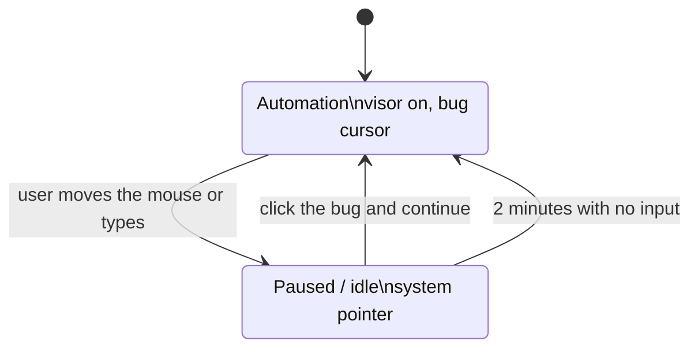

# hypermesh-visor

`hypermesh-visor` is a local Linux daemon a supervisor starts for a desktop session. Open a session, then call view, watch, listen, mouse, and type. Calls without a live session fail. It is not a virtual machine. This version is Linux only.

Purpose, recipes, agent, skills, and secrets are sent when the session opens. Only secrets included in that call are loaded. Url/chain/ipfs *secret* sources stay 501. Vault `source: "mcp"` (role B) materializes via a short-lived MCP tool call.

Optional `mcp_profile` on `POST /session` attaches local MCP *tool* servers from `~/.config/hypermesh/mcp.json` and `mcp-profiles.json` (same files as `hypermesh mcp`). Stdio and HTTP/SSE servers are attached (`tools/list` on connect). Closing the session kills stdio children and drops HTTP clients. Project-local `.hypermesh/mcp.json` or `.cursor/mcp.json` (cwd walk, or `HYPERMESH_MCP_PROJECT`) is merged under user config. A profile with `gateway: true` attaches only `docker-gateway`. `GET /session/{id}/mcp` returns the attached profile, servers (with `healthy`), and tools. `GET /companion` includes prefer-MCP fields: `mode` (`mcp:<id>` when a healthy binding matches the focused app, else the desktop verb), `mcp`, `prefer_mcp`, and `focused`. Focused-app detection uses X11 `WM_CLASS` and best-effort Wayland probes (Hyprland `hyprctl`, Sway `swaymsg`, KWin `qdbus`). Bindings live in `mcp-bindings.json`. `POST /session/{id}/mcp/call` invokes a tool with `approve`/`deny`; `GET /mcp-audit` lists server, tool, decision, and outcome only (never env or arguments). Vault locator is `server/tool` in `mcp.json` (role B — separate from session tool attach).

`hypermesh-desktop-mcp` is an inverse stdio MCP that wraps visor view/mouse/type for external agents (`HYPERMESH_VISOR_URL`, `HYPERMESH_SESSION_ID`).

## Linux build and tests

Stable Rust. Tests do not need a display server.

```bash
cargo test
cargo build --release
./target/release/hypermesh-visor --listen 127.0.0.1:9847
```

`--listen` must be a loopback address. Run the daemon as the logged-in user, not as root. It prints `listening 127.0.0.1:9847` when the socket is up.

## Release packages

Pull requests and `main` build Linux artifacts. Those builds are not a release. Their version is the `Cargo.toml` version plus `~ci.` and the commit. A release is a tag named `v` plus that same `Cargo.toml` version, pushed after the version is on `main`. The workflow refuses a tag that does not match.

```bash
git tag v0.1.0
git push origin v0.1.0
```

The release asset names do not include the version. `v0.1.0` publishes:

- `hypermesh-visor-x86_64`
- `hypermesh-visor-x86_64.deb`
- `hypermesh-visor-x86_64.rpm`
- `hypermesh-visor-aarch64`
- `hypermesh-visor-aarch64.deb`
- `hypermesh-visor-aarch64.rpm`
- `checksums.txt` — SHA-256 of those files

The version is inside the package. The download page uses these same filenames.

The packages install `/usr/bin/hypermesh-visor`, `/usr/bin/hypermesh`, `/usr/bin/hm`, `/usr/bin/hypermesh-companion`, and `/usr/bin/hypermesh-desktop-mcp` when present in the build. They do not start the visor. The companion is started for a graphical login from `/etc/xdg/autostart`. Run the visor as the logged-in user. Builds run on Ubuntu 24.04, the same userspace generation as the AGX JetPack 7 image.

The raw release assets `hypermesh-visor-x86_64` and `hypermesh-visor-aarch64` stay the visor binary. The `.deb` and `.rpm` names are unchanged and are the packages that contain the visor, the CLI, and the companion.

## Desktop companion

`hypermesh-companion` is a Linux-only bug on the desktop. It plays the animated states in [`companion/assets/states`](companion/assets/states/README.md). Frame order, `ms_per_frame`, and `loop` come from `states.json`. The window uses the `400x520` frames.

| State | When it shows |
| --- | --- |
| idle | The visor is reachable and was used recently, and while an automation is paused |
| automation | The visor is driving the desktop, or a caller started an automation |
| upgrading | An updater published that notice (see below). This wins even if the visor is down |
| disconnected | The visor does not answer. Three missed polls in a row count as down |
| sleeping | The visor is up, nothing is driving, and neither the companion nor the open session has been used for `sleep_after_secs` (default 900) |

While a visor session is open it paints that session's purpose and the prefer-MCP mode (`mcp:<id>` when a healthy binding matches, else `view` / `watch` / `listen` / `mouse` / `type`) under the bug in a built-in bitmap face. It does not copy the screen into the window. Clicking it opens a short menu: a terminal running `hypermesh`, MCP profiles, MCP doctor, login, billing (`https://hyperme.sh/#pricing`), renting (`https://hyperme.sh/#offers`), the desk (`https://portal.test.hyperme.sh/dashboard/hypermesh`), Eyes follow, and Bug cursor. On a short display the window is capped to the screen and the wheel scrolls the rows, so the last item stays reachable. Eyes follow and the bug cursor are off unless that menu row turns them on. Both choices are stored in `~/.config/hypermesh/companion.toml` (`eyes_follow_pointer`, `bug_cursor`). Pupils track the pointer only on the idle animation, and only while a session is open and eyes follow is on. `sleep_after_secs` and `automation_resume_secs` (default 120) are read from that file when the companion starts. Polls and pause posts use the Unix socket `$XDG_RUNTIME_DIR/hypermesh/companion.sock` (directory mode 0700, socket mode 0600). `HYPERMESH_RUNTIME_DIR` overrides that directory. When `XDG_RUNTIME_DIR` is unset, both sides use `$XDG_STATE_HOME/hypermesh/run`, or `~/.local/state/hypermesh/run` when that is unset too. A path that does not fit in `sun_path` fails closed. Session tools and the desktop MCP still use `HYPERMESH_VISOR_URL` (default `http://127.0.0.1:9847`) on the loopback TCP port.

The bug cursor art is in [`companion/assets/cursor`](companion/assets/cursor/README.md). How it pairs with the automation state is [Automation mode](#automation-mode).

### Automation mode

The top-down bug cursor and the automation state are one behavior. The visor is the bug using VR to do the tasks.

While an automation runs, the companion shows the automation state and the pointer is the bug cursor. The system sprite is hidden for that time, and a click-through window follows the pointer so a window's own cursor, such as a text caret, does not cover the bug. That path leaves the root window's cursor as it was. If the overlay cannot be created, the companion sets the root cursor and restores the default cursor on the way out. A missing extension is logged once and further overlay attempts stop. The click point is the antenna tip in `hotspot.json`. The cursor plays crawl, fly (a long move, or a fast one), reach, click, type, and busy from the latest drive sample. Reach shows only after a move has settled and that move's JSON set `"clickable": true`. The visor does not discover clickable targets. Busy shows while the automation is running and the latest sample is not a fresh move, click, or type.

`POST /session/{id}/mouse` and `POST /session/{id}/type` enter `running`, except while the injection backend is Wayland. Those calls are refused and do not enter `running`. `view`, `watch`, and `listen` do not. There is no separate automation runner. `POST /companion/automation` with `{"action":"start"}` or `"stop"` is that seam. `start` needs an open session. While a session is already driving, `start` keeps that session. It uses the most recently touched session only when the gate is off. `stop` ends the phase without closing the session. Closing the driving session ends a running automation. It does not clear a user pause.

A real mouse move, button press, or key press pauses the automation. The companion posts `pause`. Until that lands, a drive already in flight can still inject. After it lands, mouse and type return 409 `{"error":"automation paused"}` and do not inject. XInput2 raw events whose device or source is an XTEST device are the visor's own input and are ignored. The visor publishes its injection backend on `GET /companion`, and the companion applies that before it reads queued raw events. While `backend` is `wayland`, automation is disabled until issue #17 lands. `POST /companion/automation` with `start` or `resume`, and session `mouse` and `type`, return 501 and the error `Automation is disabled on Wayland until the portal backend lands (#17)`. They do not inject. The portal pointer and keyboard code stays in the visor and is not called. The companion does not show the visor state. The menu shows that sentence, and the companion logs it once. Idle, sleeping, disconnected, and upgrading keep working, and the optional bug cursor still follows the pointer. `view`, `watch`, and `listen` stay available. If XInput2 or an XTEST device cannot be identified, the companion compares the pointer with the last drive point once the companion has been showing that sample for 150 ms, and pauses when it is more than 12 px away. A single poll is not enough: the move can reach the screen before that poll fetched the new drive, so the mismatch has to still be there on two later polls of the same sample. A new button in the pointer mask pauses too. The drive sample is published only after the visor has pressed and released, so a button that goes down once that sample is visible is a physical press. A press and release shorter than one frame can be missed, and this fallback cannot see key presses. Before `mouse` or `type` runs, the visor publishes `injecting` and bumps `inject_seq`. It clears `injecting` when the call finishes and publishes `last_settled_seq` for that sequence, including when the call fails, so a failed injection stops deferral on the next poll. While a sequence is still outstanding, the fallback defers button and displacement checks. Back-to-back injections share one 2 second budget from the last poll that showed no injection in flight, so a new sequence does not restart the wait. Samples seen during that wait are not copied into the baseline. When the injection settles, or the budget runs out, a move or a button change is judged against the pointer from before the deferral, or against a usable drive. A hung chain cannot suppress pausing past that budget. When there is no usable drive (just after start or resume, or a type sample with no pointer), the fallback keeps a live pointer baseline and pauses on a later move or button change. The injection marker keeps the visor's own move off that baseline until the wait ends. While paused, that fallback keeps watching the pointer and buttons against the sample taken when the pause began, and a later change restarts the resume timer. `resume` and `start` drop that drive sample and bump a resume sequence. The companion ignores a drive from the sequence before that transition, so a sample recorded between the resume and the poll that reports it still counts, and a later user move still pauses. The visor poll and those posts run on a side thread, so a slow reply does not freeze the cursor or hold the pause. Polls wait 40 ms while the automation is running or paused, and 250 ms otherwise. `GET /companion` caches the focused app for about 750 ms and refreshes it off the request worker, so a Wayland focus probe is not spawned on every poll. On pause the companion drops the visor, shows idle, and the system cursor comes back.

While paused, clicking the companion bug asks whether to continue. Continue posts `resume`. The automation also resumes after `automation_resume_secs` (default 120) with no user input. A later `running` report follows that pause when its resume sequence is newer than the sequence at the pause, including when the poll skipped the `paused` state. A `running` report with the same sequence is from before the pause and is ignored. A `paused` report while a local resume is in flight is ignored when its resume sequence is the one that pause was based on, or older. A newer sequence is a re-pause and is followed. Further mouse or keyboard input during that wait keeps it paused and restarts the timer. On resume the visor state and the bug cursor come back.

| Case | What the companion does |
| --- | --- |
| Start, or resume, with no usable drive | The first pointer sample is the baseline. A later move of more than 12 px, or a button change, pauses. |
| Type sample with no pointer | The same baseline. The type coordinates are not a target. |
| Click or drag in flight | Button and displacement checks wait while an injection is outstanding. The whole chain shares one 2 second budget from the last quiet poll. Samples during the wait stay off the baseline. |
| Failed mouse or type | `last_settled_seq` catches up to `inject_seq`, and the next poll classifies immediately. |
| Click or drag after that drive is visible | Displacement is compared with the drive and has to survive two later polls. Age is how long the companion has been showing that sample. A button pauses only when it is newly pressed. |
| Injection still open after 2 seconds | Checks resume against the pointer from before the deferral, so a move during the wait still pauses. |
| TCP `start` clears the drive | The baseline still pauses on a later physical move. |
| Re-pause while a resume is in flight | A paused snapshot counts when its `resume_seq` is newer than the pause. The same or an older sequence is ignored. |
| Backend is Wayland | Automation stays off until issue #17. The companion does not enter the visor state. Idle, sleeping, disconnected, upgrading, and the optional bug cursor keep working. |
| Reconnect | The same `resume_seq` does not undo a local pause. A newer running snapshot follows. |
| Missed poll | The poll epoch does not bump, so a displacement does not confirm. |

Lifting a pause is reserved for the companion process running as the same user. The visor listens on `$XDG_RUNTIME_DIR/hypermesh/companion.sock` (directory mode 0700, socket mode 0600). `HYPERMESH_RUNTIME_DIR` overrides that directory. When `XDG_RUNTIME_DIR` is unset, both sides use `$XDG_STATE_HOME/hypermesh/run`, or `~/.local/state/hypermesh/run`. The directory is created mode 0700 and the owner is checked. A path that does not fit in `sun_path` is refused. A second visor leaves a live socket in place and exits with `visor already running`. It binds the TCP port before it replaces a stale socket file. The companion polls and posts there, and both ends check `SO_PEERCRED` before any request bytes are written or read. A peer uid that is not the current user is dropped. `resume`, and `start` or `stop` while the gate is paused, are accepted only on that socket. The same actions on the loopback TCP port are refused, including with a header, and deleting the driving session does not clear the pause. Pause itself, and `start` while the gate is off, stay on TCP. Session tools (`view`, `mouse`, `type`, and the desktop MCP tools) stay on TCP and cannot lift a pause. A different OS user cannot connect. A process running as the same user can, because it is the same user; there is no separate bearer token to steal from a listener on the TCP port. Windows and macOS need the same boundary with a named-pipe ACL and an XPC or peer audit token, tracked in issue #18. `companion.toml` is TOML: `sleep_after_secs = 1_800` and `automation_resume_secs = 600 # ten minutes` are read as written. An invalid value logs a warning and that setting stays at its default.

Away from an automation the bug cursor stays off unless `bug_cursor` is true.

The system cursor is restored when the companion exits, when the visor is disconnected, and if the window loop unwinds. The X server also drops a client's cursor when the connection closes. The pointer change is the X11 cursor, including XWayland. A Wayland-native cursor that does not go through XWayland is left as it is.

Upgrading is not inferred. Publish it with `POST /companion/notice` and `{"notice":"upgrading"}` (`{"notice":"clear"}` removes it), or write the single word `upgrading` to `~/.config/hypermesh/companion-notice`.



Sign in opens your browser; after you approve, Hypermesh stores your session in your system keychain. On a machine without a browser, use `hypermesh login --device`.

The public Keycloak client is `hypermesh-native` in realm `controlplane` at `https://auth.test.hyperme.sh`. It has no client secret. It must allow the loopback redirect `http://127.0.0.1/callback` with any port (register that URI with no port; do not pin port 3000), require PKCE S256, and enable the device authorization grant. Sign-in requests the `openid` scope only. The refresh token is the normal SSO-session token, stored once under keychain service `hypermesh` and account `session`, which the CLI and the companion both read. Access tokens stay in memory. When the Keycloak session ends, Hypermesh clears that entry and asks you to sign in again. `hypermesh logout` revokes the refresh token and deletes the entry. The companion polls `GET /companion` on its Unix socket and does not put the session in the visor vault.

The window uses X11, including XWayland. It needs `DISPLAY`.

```bash
curl -s -X POST http://127.0.0.1:9847/session \
  -H 'content-type: application/json' \
  -d '{"purpose":"look at the desktop","recipes":[],"agent":{"name":"local","instructions":""},"skills":[]}'
```

## Verb checks

`ci/verbs.sh` starts the daemon with `--fixture` and calls view, watch, listen, mouse, and type with fixed HTTP bodies. View and watch must return the frame in `tests/fixtures/view.png.b64`. Listen must return the audio in `tests/fixtures/listen.pcm.b64`. Mouse and type checks read the coordinates, buttons, and keystrokes written by the input path. GitHub Actions runs that script. It does not call a model.

`GET /session/{id}/feed` is the renter document for that session. It carries the latest desktop snapshot as a handle (`mime`, `seq`) and the terminal or IDE activity the visor already saw: focused app, typed text, named keys, mouse action, MCP server and tool, stream prompts, file names, and secret names. `GET /session/{id}/feed/snapshot` returns the PNG already captured by view or watch. It does not take another screenshot. Secret values and file bytes are not on the feed. The handle and the activity are what s3r.ch stores and shows. The PNG is not written into Gun.

`--fixture` does not attach to the logged-in desktop. Without it, the daemon is unchanged.

`ci/hypermesh-judge-hook.sh` is reserved for a later internal hyperme.sh test key that can run real tasks and judge them. Actions does not run it, and the script does not call that API.

## Prompt orchestrator

`POST /prompt` asks the orchestrator for a catalog id, then forwards the prompt through one door. `--default-model` (or `HYPERMESH_DEFAULT_MODEL`) is that id when the caller omits `model`. It starts as `llama-3.1-8b-q4`. An explicit id is checked against the in-tree catalog and the live net before any door. An unknown id is rejected.

`--supervisor-url` is the only door until `--supervisor-url-2` is also set. Two hosts need `--route CATALOG=URL`. A model with no route is not sent. A failed door is tried again only on another host that route already names. `--experts CATALOG` fans that id across both hosts and returns one answer: the first host, unless `--expert-answer CATALOG=URL` names the other. One expert failing fails the prompt.

A `kind: prompt` line on `POST /session/{id}/stream` is kept on the inbox and also enters that same pass. Secret and file lines do not. The audit row records the forwarded model, the door authority when one was selected, and a secret or PII finding without the secret value.
